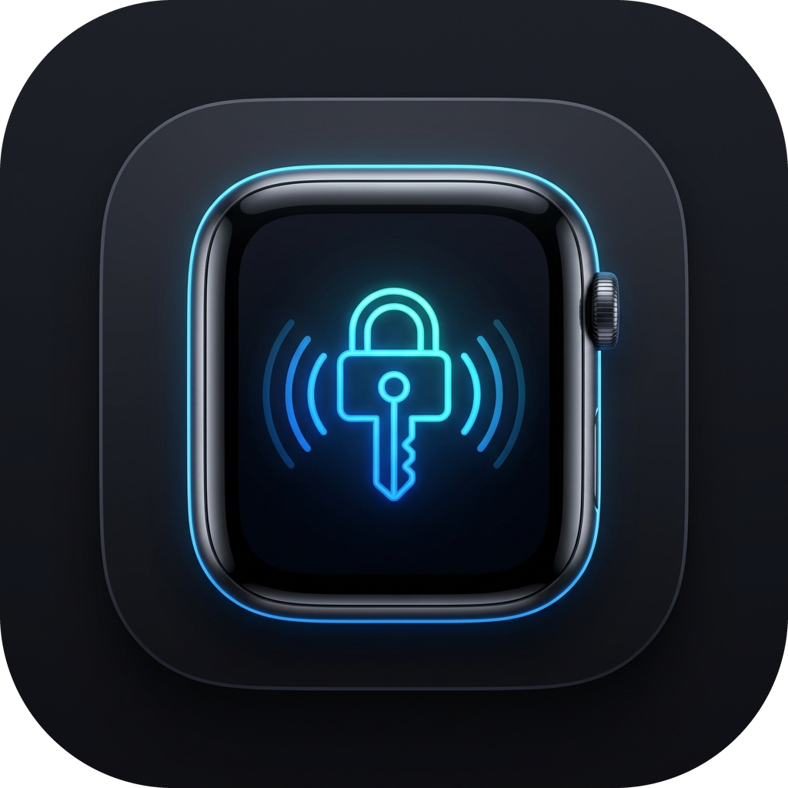
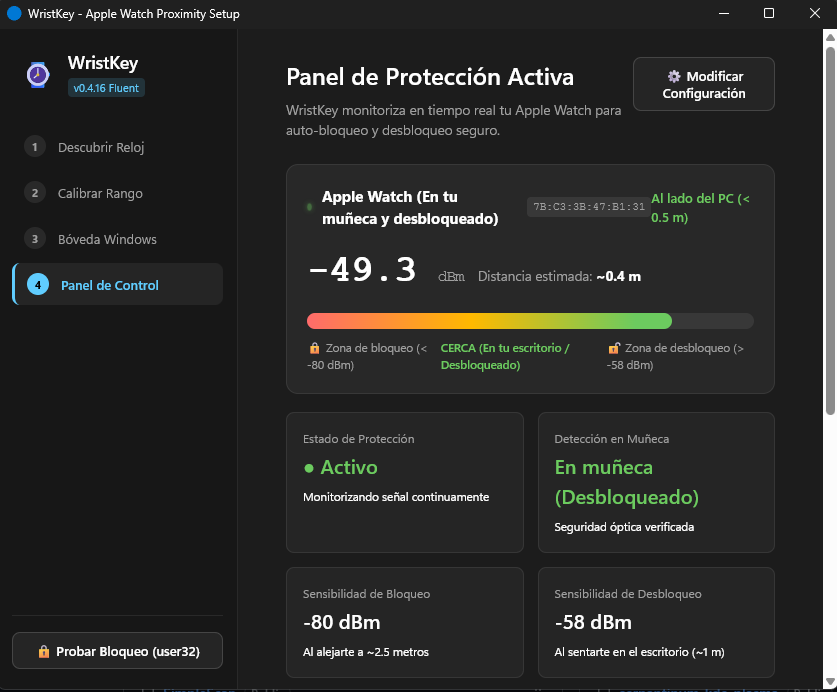
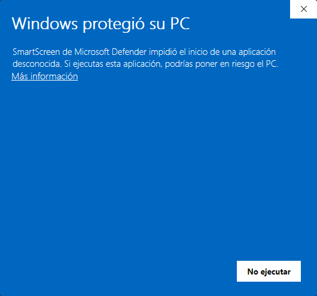
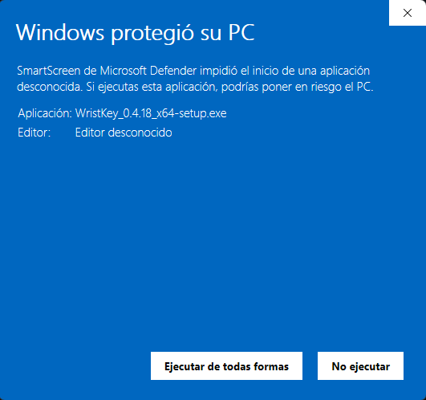

<p align="center">
  
</p>

<h1 align="center">WristKey</h1>

<p align="center">
  <strong>Proximity Auto-Lock & Hands-Free Unlock for Windows 11 / 10 using Apple Watch via BLE</strong><br>
  <em>The seamless macOS Auto Unlock experience brought natively to Windows.</em>
</p>

<p align="center">
  <a href="https://github.com/jorjanion/WristKey/releases/latest"></a>
  <a href="LICENSE-MIT"></a>
  
  
  
  
</p>

<p align="center">
  🌐 <strong>Languages / Idiomas:</strong><br>
  <strong>English (Main)</strong> | 
  <a href="docs/translations/README.es.md">Español</a> | 
  <a href="docs/translations/README.fr.md">Français</a> | 
  <a href="docs/translations/README.pt.md">Português</a> | 
  <a href="docs/translations/README.de.md">Deutsch</a> | 
  <a href="docs/translations/README.it.md">Italiano</a> | 
  <a href="docs/translations/README.zh-CN.md">简体中文</a> | 
  <a href="docs/translations/README.ko.md">한국어</a> | 
  <a href="docs/translations/README.ja.md">日本語</a>
</p>

---

<div align="center">
  
  <p><em>Real-Time Active Protection Panel · Continuous RSSI tracking and optical on-wrist validation</em></p>
</div>

---

## ⚡ Why WristKey?

Windows includes a feature named *Dynamic Lock*, but it falls short for daily productivity. **WristKey** overcomes these limitations by implementing genuine proximity tracking through Apple Continuity protocol analysis:

| Feature | Windows Dynamic Lock | WristKey |
| :--- | :--- | :--- |
| **Walk-Away Auto-Lock** | ❌ Slow (waits up to 1-2 minutes) | ✅ **Instant & Configurable** (asymmetric RSSI filter) |
| **Approach Auto-Unlock** | ❌ Not supported (lock only) | ✅ **Hands-Free Automatic Unlock** (Credential Provider) |
| **On-Wrist Optical Check** | ❌ None (remains active on desk/charger) | ✅ **Continuity 0x004C Verified** (revokes access when taken off) |
| **Battery Consumption** | ❌ High (continuous classic Bluetooth polling) | ✅ **Ultra-Low Power** (passive BLE advertisements) |
| **Address Privacy (RPA)** | ❌ Fails when BLE MAC rotates | ✅ **Hardware AES-128 IRK Resolution** (`ah(IRK, prand)`) |
| **Credential Security** | N/A | ✅ **Encrypted via Windows DPAPI** (never in plaintext) |

---

Similar to the native **Auto Unlock feature in macOS** and **`watch-unlock-rs` in Linux**, **WristKey** continuously monitors your Apple Watch in the background via Bluetooth Low Energy (BLE):
- 🔒 **Automatically locks your PC** whenever you step away from your desk.
- 🔓 **Wakes the display and logs you back in** the moment you sit down.
- 🛑 **Optical On-Wrist Security:** If you take off the watch or lock it with a passcode, access is immediately revoked.

---

## 📥 Installation

Download the official standalone installer from the **[GitHub Releases](https://github.com/jorjanion/WristKey/releases)** page:
* 📦 **[WristKey_0.4.19_x64-setup.exe](https://github.com/jorjanion/WristKey/releases/download/v0.4.19/WristKey_0.4.19_x64-setup.exe)**

Run the `.exe` installer. It includes language selection during setup (English, Spanish, French, Portuguese, German, Italian, Chinese, Korean, Japanese) and allows switching languages at any time directly within the application.

---

### ⚠️ Why Does Windows SmartScreen Show a Warning?

When running the installer for the first time on Windows 11 or 10, Microsoft Defender SmartScreen may display a blue warning screen (*"Windows protected your PC"*):

<div align="center">

| **Step 1:** Click on **"More info"** | **Step 2:** Click **"Run anyway"** |
| :---: | :---: |
|  |  |

</div>

#### Why does this happen?
1. **Cloud Telemetry Reputation:** SmartScreen is Microsoft's telemetry-based reputation system. Each newly compiled release (`v0.4.19`, etc.) produces a fresh binary with a unique cryptographic hash that hasn't accumulated tens of thousands of downloads in Microsoft's telemetry database yet.
2. **Cost of EV Code Signing Certificates:** To suppress warnings on newly compiled desktop apps, Microsoft requires developers to buy an *Extended Validation (EV) Code Signing Certificate*, which costs **$300 to $500 per year** through enterprise certificate authorities (DigiCert, Sectigo). For independent, community-driven open-source projects, this cost is prohibitive.
3. **100% Verifiable Security & Privacy:**
   - WristKey is **100% Open Source**.
   - You can inspect every line of Rust code directly in this repository.
   - User credentials are encrypted locally on your machine via **Windows DPAPI** (`CryptProtectData`) tied to your Windows user account master key.
   - Zero third-party telemetry, tracking, or external network requests.

#### How to proceed with installation:
1. On the initial SmartScreen dialog, click the underlined link: **"More info"** (*"Más información"*).
2. The **"Run anyway"** (*"Ejecutar de todas formas"*) button will appear in the bottom-left corner; click it to proceed.

---

## 🏗️ Architecture & Security

1. **RPA Resolution (AES-128 IRK):**
   Apple devices rotate their Bluetooth MAC address every ~15 minutes (Resolvable Private Address). WristKey resolves RPAs against the paired watch's Identity Resolving Key (IRK) using hardware AES-128 (`ah(IRK, prand)` per Bluetooth SIG Core Spec).
2. **Apple Continuity Telemetry (0x004C):**
   Parses Apple Continuity frames (`type 0x10 Nearby Info`). If you take off the watch or lock it, watchOS asserts the lock flag; WristKey denies access until re-authenticated on wrist.
3. **DPAPI Credential Encryption:**
   Login credentials used for automatic unlock are stored using Windows DPAPI (`CryptProtectData`), encrypted with your user account master key. Plaintext passwords are not stored on disk.
4. **Named Pipe IPC:**
   Authentication between the daemon and the Windows Credential Provider communicates over a restricted local Named Pipe (`\\.\pipe\WristKeyUnlockPipe`).

```
Apple Watch (BLE Advertisement)
  │  (RPA rotated every 15 min + Apple Continuity telemetry)
  ▼
Windows BLE Watcher (WinRT)
  ▼
RPA Resolver (AES-128 IRK matching via Bluetooth Core Spec)
  ▼
Apple Continuity Parser (0x004C / 0x10 Nearby Info)
  │  Verifies watch is on wrist and unlocked (Action Code 0x0A / 0x0B)
  ▼
RSSI Asymmetric EMA Filter & Hysteresis State Machine
  ├── Walk Away (RSSI < -80 dBm or Off-Wrist)  ──> LockWorkStation()
  └── Approach  (RSSI > -58 dBm and On-Wrist)  ──> Wake Screen & Unlock via Credential Provider
```

---

## CLI Usage

The repository includes a command-line tool (`wristkey-cli`) for diagnostics, signal calibration, packet inspection, and headless background execution.

### Building from Source

Prerequisites:
* Windows 11 or Windows 10 (version 1903+)
* Bluetooth 4.2+ adapter with LE support
* Rust (edition 2021+)

```powershell
# Clone the repository
git clone https://github.com/jorjanion/WristKey.git
cd WristKey

# Run unit and cryptographic tests
cargo test
```

### Commands & Diagnostics

#### 1. Real-Time Packet Scanner (`--scan`)
Scans for nearby BLE advertisements and decodes Apple Continuity payloads (`0x004C`), showing RSSI, frame types, and raw bytes:
```powershell
cargo run -p wristkey-cli -- --scan
```

#### 2. Signal & Distance Calibrator (`--calibrate`)
Displays a live visual RSSI signal meter and estimated distance in meters:
```powershell
cargo run -p wristkey-cli -- --calibrate
```

#### 3. Extract Paired IRK Keys (`--list-keys`)
Queries `HKLM\SYSTEM\CurrentControlSet\Services\BTHPORT\Parameters\Keys` to dump paired Bluetooth LE Identity Resolving Keys (requires Administrator terminal):
```powershell
cargo run -p wristkey-cli -- --list-keys
```

#### 4. Verify Cryptographic Engine (`--verify-crypto`)
Validates the local `ah(IRK, prand)` AES-128 implementation against the official Bluetooth SIG Core Specification test vectors:
```powershell
cargo run -p wristkey-cli -- --verify-crypto
```

#### 5. Continuity Telemetry Inspector (`--telemetry`)
Real-time decoding of Nearby Info flags (on-wrist state, user activity, auto-unlock eligibility, Wi-Fi status, and auth tags):
```powershell
cargo run -p wristkey-cli -- --telemetry
```

---

## 🤝 Contributing & Community

We welcome contributions from the community! Check out our **[CONTRIBUTING.md](CONTRIBUTING.md)** guide to get started with bug reports, feature requests, and Pull Requests.

---

## Troubleshooting

1. **Bluetooth Adapter Not Recognized:** Ensure your PC's Bluetooth adapter supports Bluetooth Low Energy (BLE 4.2 or higher).
2. **Wrist Detection Disabled on Watch:** In the Apple Watch app on your iPhone, go to *Passcode* and ensure *Wrist Detection* is toggled **ON**.
3. **Display Does Not Wake:** Ensure Windows Power & Sleep settings allow peripheral wake events.

---

## License

Licensed under either of:
* Apache License, Version 2.0 ([LICENSE-APACHE](LICENSE-APACHE))
* MIT License ([LICENSE-MIT](LICENSE-MIT))

at your option.
