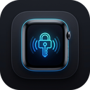

<p align="center">
  
</p>

<h1 align="center">WristKey</h1>

<p align="center">
  <strong>Proximity Auto-Lock & Hands-Free Unlock for Windows using Apple Watch via BLE</strong><br>
  <em>The seamless macOS-like Auto Unlock experience brought natively to Windows 11 and 10.</em>
</p>

<p align="center">
  <a href="https://github.com/jorjanion/WristKey/releases/latest"></a>
  <a href="LICENSE-MIT"></a>
  
  
  
  
</p>

---

## ⚡ Why WristKey?

Windows has a built-in feature called *Dynamic Lock*, but it falls short for modern workflows. **WristKey** solves these limitations by implementing genuine proximity tracking with Apple Continuity protocol analysis:

| Feature | Windows Dynamic Lock | WristKey |
| :--- | :--- | :--- |
| **Walk-Away Auto-Lock** | ❌ Slow (waits up to 1-2 minutes) | ✅ **Instant & Configurable** (via RSSI hysteresis) |
| **Approach Auto-Unlock** | ❌ Not supported (lock only) | ✅ **Hands-Free Automatic Unlock** (Credential Provider) |
| **Wrist Presence Check** | ❌ None (locks even if watch is off) | ✅ **Continuity 0x004C Verified** (denies if watch removed) |
| **Battery Efficiency** | ❌ High drain (active classic Bluetooth) | ✅ **Ultra-low power** (passive Bluetooth LE advertisements) |
| **Address Privacy (RPA)** | ❌ Fails when BLE MAC rotates | ✅ **AES-128 IRK Hardware Matching** (`ah(IRK, prand)`) |
| **Credential Security** | N/A | ✅ **Encrypted via Windows DPAPI** (never stored in plaintext) |

---

Similar to native macOS Auto Unlock and Linux `watch-unlock-rs`, WristKey continuously monitors your Apple Watch in the background:
- **Locks your workstation automatically** when you walk away from your desk.
- **Wakes the display and unlocks your session** when you return.
- **Immediately rejects presence** if the watch is removed from your wrist or locked with a passcode.

---

## 📥 Installation

Download the installer from the **[GitHub Releases](https://github.com/jorjanion/WristKey/releases/latest)** page:
* `WristKey_0.4.17_x64-setup.exe`

Run the installer to set up the application, desktop shortcut, and system tray background agent.

---

## Architecture & Security

1. **RPA Resolution (AES-128 IRK):**
   Apple devices rotate their Bluetooth MAC address every ~15 minutes (Resolvable Private Address). WristKey resolves RPAs against the paired watch's Identity Resolving Key (IRK) using hardware AES-128 (`ah(IRK, prand)` per Bluetooth SIG Core Spec).
2. **Apple Continuity Telemetry (0x004C):**
   Parses Apple Continuity frames (`type 0x10 Nearby Info`). If you take off the watch or lock it, watchOS asserts the lock flag; WristKey denies access until re-authenticated on wrist.
3. **DPAPI Credential Encryption:**
   Login credentials used for automatic unlock are stored using Windows DPAPI (`CryptProtectData`), encrypted with your user account master key. Plaintext passwords are not stored on disk.
4. **Named Pipe IPC:**
   Authentication between the daemon and the Windows Credential Provider communicates over a restricted local Named Pipe (`\\.\pipe\WristKeyUnlockPipe`).

```
Apple Watch (BLE Advertisement)
  │  (RPA rotated every 15 min + Apple Continuity telemetry)
  ▼
Windows BLE Watcher (WinRT)
  ▼
RPA Resolver (AES-128 IRK matching via Bluetooth Core Spec)
  ▼
Apple Continuity Parser (0x004C / 0x10 Nearby Info)
  │  Verifies watch is on wrist and unlocked (Action Code 0x0A)
  ▼
RSSI EMA Filter & Hysteresis State Machine
  ├── Walk Away (RSSI < -82 dBm)  ──> LockWorkStation()
  └── Approach  (RSSI > -62 dBm)  ──> Wake Screen & Unlock via Credential Provider
```

---

## CLI Usage

The repository includes a command-line tool (`wristkey-cli`) for diagnostics, signal calibration, packet inspection, and headless background execution.

### Building from Source

Prerequisites:
* Windows 11 or Windows 10 (version 1903+)
* Bluetooth 4.2+ adapter with LE support
* Rust (edition 2021+)

```powershell
# Clone the repository
git clone https://github.com/jorjanion/WristKey.git
cd WristKey

# Run unit and cryptographic tests
cargo test
```

### Commands & Diagnostics

#### 1. Real-Time Packet Scanner (`--scan`)
Scans for nearby BLE advertisements and decodes Apple Continuity payloads (`0x004C`), showing RSSI, frame types, and raw bytes:
```powershell
cargo run -p wristkey-cli -- --scan
```

#### 2. Signal & Distance Calibrator (`--calibrate`)
Displays a live visual RSSI signal meter and estimated distance in meters. Use this to determine optimal lock and unlock thresholds for your workspace:
```powershell
cargo run -p wristkey-cli -- --calibrate
```

#### 3. Extract Paired IRK Keys (`--list-keys`)
Queries `HKLM\SYSTEM\CurrentControlSet\Services\BTHPORT\Parameters\Keys` to dump paired Bluetooth LE Identity Resolving Keys (requires Administrator terminal):
```powershell
cargo run -p wristkey-cli -- --list-keys
```

#### 4. Verify Cryptographic Engine (`--verify-crypto`)
Validates the local `ah(IRK, prand)` AES-128 implementation against the official Bluetooth SIG Core Specification test vectors:
```powershell
cargo run -p wristkey-cli -- --verify-crypto
```

#### 5. Continuity Telemetry Inspector (`--telemetry`)
Streams decoded Apple Continuity `0x10 Nearby Info` bitfields in real-time (on-wrist status, passcode lock state, auto-unlock flag, Wi-Fi status):
```powershell
cargo run -p wristkey-cli -- --telemetry
```

#### 6. Configure Credential Vault (`--setup-credentials` / `--test-vault`)
Prompts for Windows user credentials and encrypts them using Windows DPAPI for session unlock:
```powershell
# Store credentials in encrypted DPAPI vault
cargo run -p wristkey-cli -- --setup-credentials

# Verify vault decryption
cargo run -p wristkey-cli -- --test-vault

# Remove stored vault
cargo run -p wristkey-cli -- --clear-credentials
```

#### 7. Headless Proximity Daemon (`--auto-lock` / `--auto-unlock`)
Runs the proximity tracking loop directly in terminal with custom thresholds:
```powershell
cargo run -p wristkey-cli -- --auto-lock --auto-unlock --lock-threshold -82 --unlock-threshold -62
```

---

## Project Structure

```
WristKey/
├── .github/workflows/       # GitHub Actions automated release workflow
├── crates/
│   ├── wristkey-core/       # WinRT BLE scanner, RPA crypto, Apple Continuity, DPAPI, RSSI filter
│   ├── wristkey-cli/        # Diagnostic CLI and terminal tools
│   ├── wristkey-credprov/   # Windows Credential Provider COM DLL for session unlock
│   ├── wristkey-daemon/     # Background service and tray agent
│   └── wristkey-ui/         # Windows 11 Fluent UI Setup Wizard (Tauri v2)
└── README.md
```

---

## Contributing

Contributions, bug reports, and pull requests are welcome.

### Reporting Issues
When opening an issue, please include:
- Windows version and build number (`winver`).
- Bluetooth adapter model / chipset.
- Apple Watch model and watchOS version.
- Steps to reproduce the problem and relevant output from `wristkey-cli --scan` or `wristkey-cli --telemetry`.

### Submitting Pull Requests
1. Fork the repository and create a new branch (`git checkout -b feature/your-feature`).
2. Ensure code follows formatting guidelines (`cargo fmt`).
3. Run linter and tests to make sure everything passes:
   ```powershell
   cargo test
   cargo clippy --all-targets
   ```
4. Commit your changes with clear, descriptive commit messages.
5. Push to your branch and open a Pull Request.

---

## License

Dual-licensed under [MIT](LICENSE-MIT) or [Apache-2.0](LICENSE-APACHE).
